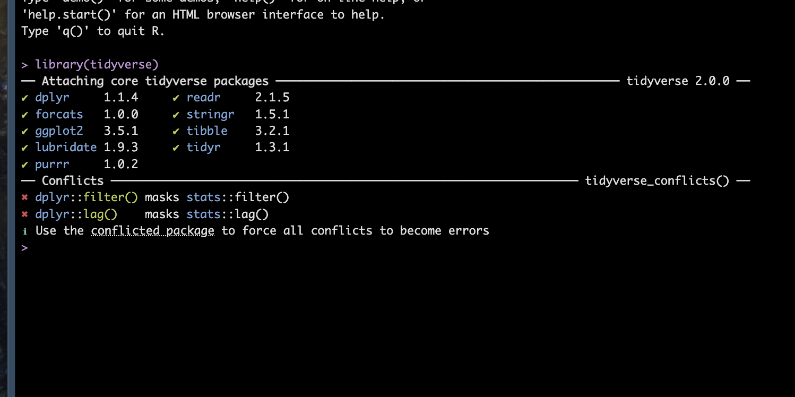
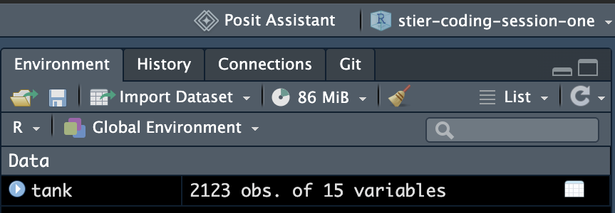
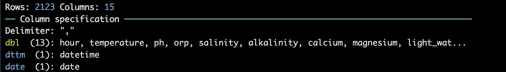
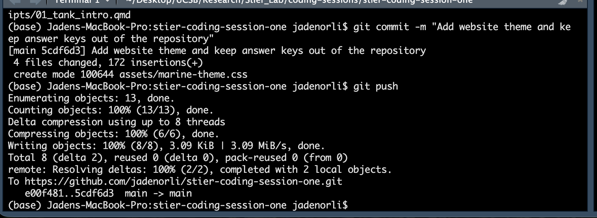

## Welcome!

- Every Thursday, 11:00 to 12:00, Room 1165 (Zoom link in the calendar invite)
- We will learn **R** for working with data and **GitHub** for saving and sharing code
- No experience needed. Questions are always welcome.

::: {.callout-box}
**If you are already set up,** you are my helpers for the next 20 minutes!
:::

::: notes
Show the rendered answer key in a browser tab as a preview of where we are headed: "By the end of today or next week, you'll each have a page like this, made from real data from our tank."
:::

## Today's plan

| Time | What |
|---|---|
| 0 to 5 minutes | Welcome |
| 5 to 30 minutes | Install R, RStudio, and Git, and make a GitHub account |
| 30 to 40 minutes | Get your own copy of the activity |
| 40 to 55 minutes | Start the activity: data from our reef tank |
| 55 to 60 minutes | Save your work to GitHub |

## The four tools

| Tool | What it is | Analogy |
|---|---|---|
| **R** | The programming language | The engine |
| **RStudio** | The program you write R in | The dashboard |
| **Git** | Tracks every version of your files | Unlimited "undo" with notes |
| **GitHub** | A website that stores your Git history online | Google Drive for code |

::: notes
Key idea: R and RStudio are separate installs. Git and GitHub are also separate: Git is a program on your computer, GitHub is a website.
:::

## Mac users: start this first

Git takes the longest to install, so start it now and let it run.

1. Open the **Terminal** app (press **Command + Space** and type "Terminal")
2. Paste this and press **Return**:

```bash
xcode-select --install
```

3. Click **Install** in the window that pops up, and accept the license

::: {.check-box}
Says **"already installed"**? You already have Git!
:::

::: notes
This can take 10 or more minutes on campus Wi-Fi. Get every Mac user started before moving on.
:::

## Step 1: Install R

Go to **<https://cran.r-project.org/>**

| Your computer | Click |
|---|---|
| Mac with an Apple chip (M1, M2, M3, M4) | **Download R for macOS**, then the **arm64** installer |
| Mac with an Intel chip | **Download R for macOS**, then the **x86_64** installer |
| Windows | **Download R for Windows**, then **base**, then **Download R for Windows** |

Open the downloaded file and click through the installer with the default options.

::: {.small}
Not sure which Mac you have? Click the Apple menu, then **About This Mac**, and look at **Chip**.
:::

## Step 2: Install RStudio

Go to **<https://posit.co/download/rstudio-desktop/>**

1. Skip step 1 on that page (you just installed R)
2. Click the big **Download RStudio Desktop** button
3. Open the file and install it. **Mac:** drag RStudio into **Applications**. **Windows:** use the default options.

::: {.check-box}
**Check:** open RStudio. The **Console** (bottom left) should start with a line like mine (yours may be newer):

```
R version 4.4.1 (2024-06-14) -- "Race for Your Life"
```
:::

## Step 3: Install Git

| Your computer | What to do |
|---|---|
| **Mac** | Already started with `xcode-select --install`. Wait for it to finish. |
| **Windows** | Go to **<https://gitforwindows.org/>**, download, and install with all the default options |

Then **quit and reopen RStudio**.

::: {.check-box}
**Check:** in RStudio, click the **Terminal** tab (next to **Console**), type `git --version`, and press Enter. You should see something like `git version 2.4...`
:::

::: notes
If RStudio does not find Git: Tools, Global Options, Git/SVN, set the Git executable (Mac: /usr/bin/git; Windows: C:/Program Files/Git/bin/git.exe), then restart RStudio.
:::

## Step 4: Make a GitHub account

Go to **<https://github.com/signup>**

- **Username:** pick something you would be happy to share professionally. It shows up in all your links (for example, `github.com/yourname`).
- **Email:** a personal email keeps the account after you graduate. You can add your UCSB email later.
- Choose the **free** plan

::: {.small}
Optional: students can get extra perks free through GitHub Education at <https://education.github.com/>
:::

## Step 5: Install the R packages we need

In the RStudio **Console** (bottom left), paste this and press Enter:

```r
install.packages(c("tidyverse", "usethis"))
```

| Package | What it does |
|---|---|
| **tidyverse** | Tools for working with data and making plots |
| **usethis** | Helpers for connecting RStudio to GitHub |

::: {.small}
This can take 5 to 10 minutes. Let it run while we keep going.
:::

## Check: did the packages install?

When the install finishes, run this in the **Console**:

```r
library(tidyverse)
```

Here's what it looks like for me. The **Conflicts** note at the bottom is normal.

{fig-align="center" width="75%"}

## Step 6: Tell Git who you are

In the **Console**, paste this, then change my name and email to **yours**:

```r
usethis::use_git_config(
  user.name = "Jaden Orli",
  user.email = "jadenorli@gmail.com"
)
```

| Setting | Use |
|---|---|
| `user.name` | Your **first and last name**, with a space (not your GitHub username) |
| `user.email` | The **same email you used for GitHub**, so your work links to your profile |

## Step 7: Connect RStudio to GitHub

GitHub does not accept your password from RStudio. Instead, you make a **token**, which works like a special password just for RStudio.

1. In the **Console**, run:

```r
usethis::create_github_token()
```

2. A GitHub page opens. Add a **Note** (like "RStudio laptop") and set **Expiration** to 90 days or longer
3. Scroll down and click **Generate token**

## Step 7, continued: save your token

4. **Copy the token** (it starts with `ghp_`). You will only see it once!
5. Back in the **Console**, run this and paste the token when asked:

```r
gitcreds::gitcreds_set()
```

::: {.callout-box}
A token is like a password: never paste it into a file or share it.
:::

::: notes
This is the step that trips people up most. If gitcreds asks whether to replace an existing credential, choose the option to replace it.
:::

## Check: are you all set?

Run this in the **Console**:

```r
usethis::git_sitrep()
```

Look for these lines:

| Line | Should show |
|---|---|
| `Name` and `Email` | Your name and GitHub email |
| `Personal access token for 'https://github.com'` | `<discovered>` |
| `GitHub user` | Your GitHub username |

::: {.callout-box}
**All set?** Help a neighbor! **Stuck?** Raise your hand.
:::

## Get your own copy of the activity

1. Go to **<https://github.com/jadenorli/stier-coding-session-one>**
2. Click the green **Use this template** button, then **Create a new repository**
3. **Owner:** your account. **Name:** `stier-coding-session-one`. Choose **Public**, then **Create repository**
4. On **your new repository**, click **Code** and copy the `https://` link
5. In RStudio, go to **File**, then **New Project**, then **Version Control**, then **Git**, and paste the link

::: {.callout-box}
Check the link before you paste it: it should contain **your** username, not `jadenorli`.
:::

## What is in your project

| File or folder | What it holds |
|---|---|
| `scripts/01_tank_intro.qmd` | **The activity.** Open this one! |
| `data/tank_data.csv` | Two weeks of readings from the Stier Lab reef tank |
| `assets/` | Colors and fonts for your rendered page |
| `README.md` | Instructions and a guide to every data column |

Open `scripts/01_tank_intro.qmd` from the **Files** tab and click **Render**. A web page should open.

::: notes
Red or coral error boxes at the blanks are expected before students fill them in.
:::

## What it looks like for me

After running Part 1, `tank` appears in the **Environment** panel (top right), with your project name above it:

{fig-align="center" width="58%"}

And `read_csv()` reports what it loaded:

{fig-align="center" width="86%"}

## The data: our reef tank

- The tank's **Apex** controller records readings **every 10 minutes**
- Two weeks: **October 9 to October 23, 2026**
- Water chemistry: temperature, pH, salinity, oxidation reduction potential
- Equipment power: lights, heater, pumps
- Something unusual happened on **October 21**. Can you find it?

::: notes
Do not give away the pump outage. Let them find it in Part 4 and Part 5.
:::

## How to run code in a Quarto document

| To run | Do this |
|---|---|
| One line | Cursor on the line, then **Command + Enter** (Mac) or **Control + Enter** (Windows) |
| A whole chunk | Click the green ▶ in the chunk's top right corner |
| The whole document | Click **Render** |

Replace each `____` with your own code, and type answers below each **Question**.

## Saving your work to GitHub

Git saves work in two steps: **commit** (save a snapshot on your computer) and **push** (upload it to GitHub).

1. Save the file (**Command + S** or **Control + S**)
2. In the **Git** tab (top right), check the box next to your file
3. Click **Commit**, write a short message like "Started session 1", and click **Commit**
4. Click **Push** (the green up arrow)

::: {.check-box}
**Check:** refresh your repository page on GitHub. Your changes should be there.
:::

## What a successful push looks like

Here's mine. The last line, ending in `main -> main`, means it worked.

{fig-align="center" width="85%"}

::: {.small}
If you used the **Push** button, the same text appears in a small window. Close it when you see `main -> main`.
:::

## When things go wrong

| Problem | Fix |
|---|---|
| No **Git** option in **New Project** | Restart RStudio. If that fails, **Tools**, then **Global Options**, then **Git/SVN** |
| **Push** asks for a password | Redo Step 7 (the token) |
| **Push** says permission denied | You cloned the template, not your copy. Check the link has your username. |
| `could not find function "ggplot"` | Run `library(tidyverse)` first |
| `'../data/tank_data.csv' does not exist` | The `.qmd` must stay in the `scripts` folder |
| Nothing will install | Use **<https://posit.cloud/>** in your browser for today |

## Before next week

- Finish the activity through **Part 5: Tank detective**
- Commit and push your work
- Stuck? Email me, or bring your questions next Thursday

::: {.small}
More help: *Happy Git and GitHub for the useR*, a free guide at <https://happygitwithr.com/>
:::

## Coming up

| Week | Topic |
|---|---|
| 2 | R basics: objects, vectors, functions |
| 3 | Data frames and reading data |
| 4 and 5 | Cleaning and summarizing data with dplyr |
| 6 and 7 | Plotting with ggplot2 |
| 8 | Collaborating with branches and pull requests |
| 9 | Reproducible reports with Quarto |
| 10 | Showcase |

::: notes
This follows the quarter outline from planning. Adjust to the group's pace.
:::
